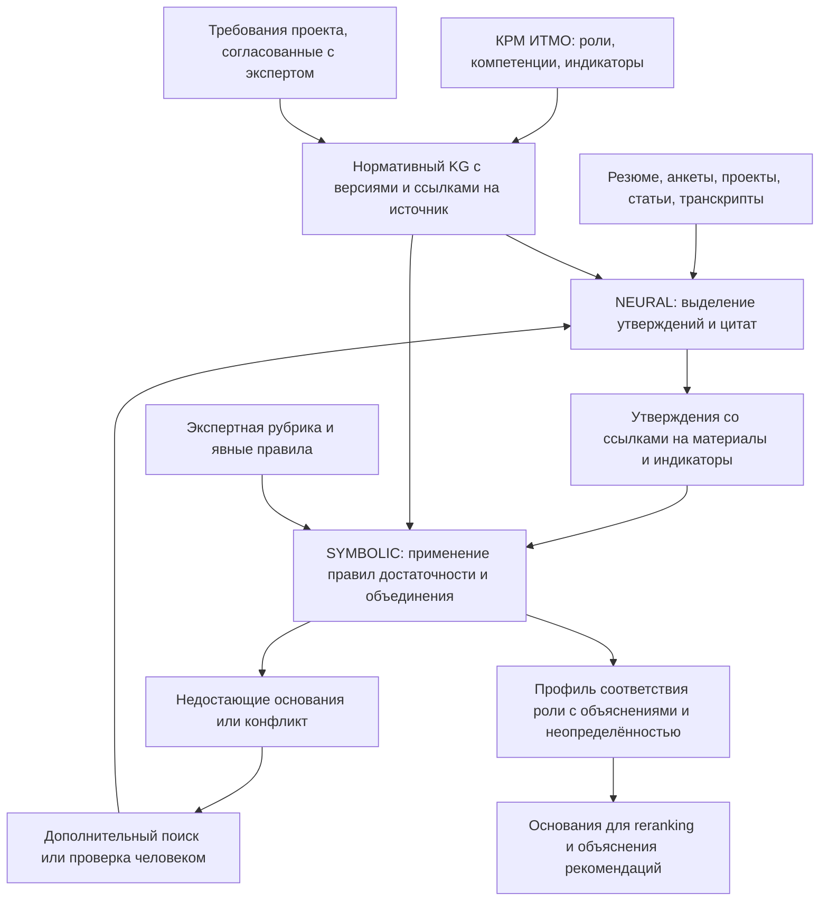

# 02.1. Соответствие кандидата роли: поиск и оценка свидетельств

Материал для подготовки к созвону команды трека B. Постановка уточнена Антоном 09.11.2026; конкретный метод, правила оценки и эксперимент предстоит согласовать. Результаты основного исследования 02.1 пока не получены. На 20.11.2026 у компонента извлечения Кирилла есть прототип и предварительные эксперименты; их статус и ограничения описаны отдельно ниже.

## Обязательное чтение перед созвоном

**Всем участникам необходимо до созвона прочитать этот README и ознакомиться со всеми источниками ниже.** Они задают общую основу обсуждения: исходную задачу трека B, предложения команды и метод Lê et al.

- [Исходная концепция трека B](../concept_ru.md).
- [Идея Антона](../drafts/anton-neurosymbolic-idea.pdf): нейросимвольная оценка, неопределённость и дальнейшая доменная адаптация.
- [Идея Кирилла v2](../drafts/kirill-competency-graphs-masking-v2.pdf): выбор компетенции по ключевым выражениям и ограниченное извлечение цитат. Упомянутая LLM-as-Jev — возможный baseline; отождествление всей схемы с JEV не установлено.
- [Реализация подхода Кирилла: обзор на 20.11.2026](kirill-logit-masking.md): две версии пайплайна, карта кода, предварительные результаты КРМ и ESCO / Skill-XL, ограничения и открытые работы для планирования 02.1.
- [Предложение Дарьи](../publication-plan.md): достаточность свидетельства, личный вклад и независимая проверка. Прочитано 09.11.2026; SHA файла `0ad97c830bcaed107bd5a4242bcba9cfd5e99e39`. Эксперименты не проведены.
- Lê, Abel, Laforge: [локальный PDF v1](../articles/2605.28483v1.pdf), [arXiv](https://arxiv.org/abs/2605.28483). Для обсуждения особенно важны §3.4, §4.4 и §6.
- [Вакансия Bosch, REF300261C](https://jobs.smartrecruiters.com/BoschGroup/744000159866869-phd-neurosymbolic-reasoning-for-domain-adaptive-generative-ai): символические знания для доменной адаптации без масштабного переобучения. Источник мотивации, не подтверждение новизны нашего метода.

## Что хотим получить

**Основной результат — метод оценки того, насколько кандидат соответствует конкретной роли и какими материалами это соответствие обосновано.** Метод должен находить свидетельства в материалах кандидата, оценивать их убедительность и достаточность (evidence strength), а затем формировать профиль соответствия требованиям роли с проверяемыми объяснениями.

Например, нам недостаточно найти слово «Python». Нужно понять, что именно человек делал, относится ли это к требованиям выбранной роли и достаточно ли описания, чтобы подтвердить соответствие. Если данных мало или они противоречат друг другу, система должна это показывать.

**Дополнительный результат или отдельное продолжение — оценка уровней компетенций:** какой именно уровень по КРМ подтверждают найденные свидетельства. Это возможная основа второй статьи; первая работа не обязана включать полноценное определение уровней по всем индикаторам.

Публикационный ориентир — 1–2 статьи в журналах Q2–Q3 или на конференциях уровня A/B. Разделение на статьи будет зависеть от самостоятельности результатов и качества экспериментов; площадки ещё не выбраны.

## Как это связано с широким треком B

Трек B исследует поиск и объяснимое ранжирование кандидатов по требованиям и подтверждённым компетенциям. Подтрек 02.1 разрабатывает его первый содержательный компонент — оценку оснований соответствия роли.

Основная цепочка первой работы:

**Материалы кандидата → найденные свидетельства → связь с индикаторами КРМ и требованиями роли → проверка достаточности → профиль соответствия роли с объяснениями.**

В продолжении добавляется определение подтверждённого уровня:

**Свидетельство → индикатор КРМ → подтверждённый уровень → соответствие целевому требованию.**

Оценка отдельных свидетельств здесь — промежуточный шаг. Итог первого этапа должен включать понятный способ собрать их в оценку соответствия роли. Такой профиль затем можно использовать для reranking кандидатов и объяснения рекомендаций. Улучшение порядка кандидатов потребует отдельной проверки.

## Какие материалы используем

Планируем работать с материалами студентов:

- резюме и анкетами;
- мотивационными письмами;
- описаниями проектов, в которых они участвовали;
- при наличии — статьями, где они являются соавторами;
- транскрибациями выступлений на конференциях.

Это перечень предполагаемых источников, а не уже собранный набор данных. На созвоне нужно выяснить, какие материалы доступны и насколько подробно в них описан личный вклад.

Тип источника важен. Желание освоить навык в мотивационном письме не подтверждает владение им; соавторство в статье не означает выполнение всех описанных в ней работ. Ссылка на текст позволяет проверить основание вывода, но не удостоверяет истинность каждого заявления кандидата.

## Как может работать метод

1. **Описываем требования роли.** Выбираем роль и связанные с ней компетенции и индикаторы КРМ ИТМО 3.0. Вместе с экспертами уточняем, что требуется для конкретного проекта и какие сведения могут это подтвердить. Если требование содержит уровень, учитываем его; подробное определение уровней остаётся отдельной задачей продолжения.
2. **Находим подходящие фрагменты.** Система ищет в материалах кандидата описания действий, опыта и результатов, относящиеся к требованиям. Сохраняет точную цитату и ссылку на документ.
3. **Проверяем, что они подтверждают.** Система предлагает оценку по заранее описанным критериям: есть ли конкретное действие или результат, понятен ли личный вклад, достаточно ли контекста, нет ли противоречий. Человек проверяет предложенную оценку и при необходимости исправляет её. Это и есть предполагаемая полуавтоматическая проверка обоснованности; какие случаи обязательно передавать человеку, решим при проектировании эксперимента.
4. **Собираем оценку по требованиям роли.** По каждому требованию показываем, что подтверждено, что подтверждено лишь частично и где сведений недостаточно или есть конфликт. Затем по явным правилам формируем общий профиль соответствия. Важность требований и способ объединения оценок нужно согласовать: подробное резюме не должно автоматически получать преимущество.
5. **Объясняем результат.** Показываем, какими фрагментами обоснована рекомендация, где вывод ограничен и что стоит уточнить у кандидата. Неизвестность не приравниваем к отсутствию компетенции.

### Что понимаем под evidence strength

Нас интересует убедительность свидетельств **относительно конкретного требования**, а не абстрактная оценка качества документа. На старте рассматриваем следующие характеристики; окончательные правила и шкалу предстоит выработать на примерах.

| Характеристика | Как понимать |
|---|---|
| Прямая поддержка — direct evidence | Фрагмент непосредственно описывает нужное действие или результат кандидата. |
| Косвенная поддержка — indirect evidence | Фрагмент связан с требованием, но для вывода нужны дополнительные основания. |
| Недостаточность — insufficient evidence | Доступных сведений недостаточно, чтобы подтвердить требование. |
| Противоречие — contradictory evidence | Сведения расходятся с проверяемым утверждением или конфликтуют между собой. |

Эти характеристики могут сочетаться. Прямое описание действия может быть недостаточно подробным; несколько косвенных свидетельств могут дополнять друг друга. Поэтому не будем заранее превращать их в одну шкалу из четырёх баллов. Проверять нужно и отдельные фрагменты, и совокупность материалов по требованию. Повтор одного утверждения в резюме и анкете не следует считать двумя независимыми подтверждениями.

Условный пример: для роли нужно уметь обосновывать оценку ML-модели. «Интересуюсь ML» не подтверждает требование. Описание собственного выбора метрик и анализа ошибок даёт прямое основание для оценки. Статья с таким анализом, но без сведений о вкладе студента, требует уточнения авторства. Это иллюстрация, а не готовая рубрика КРМ.

## Зачем здесь граф и нейросимвольный подход

Граф на основе КРМ связывает роли, компетенции и индикаторы. К ним добавляются найденные свидетельства и оценки с указанием источников. Собственные правила метода следует отличать от связей и описаний, взятых из КРМ.

**Нейросетевая часть** помогает понимать текст: искать релевантные фрагменты и предлагать их связь с требованиями. **Символическая часть** задаёт проверяемые ограничения и правила: какие сущности допустимы, существует ли цитата в источнике, какие основания нужны для вывода, как учитывать недостаток данных и объединять оценки. Эксперт проверяет смысловую обоснованность по общей рубрике.

Идея Кирилла — один из вариантов извлечения: ограничивать генерацию допустимыми компетенциями и цитатами исходного текста. Она может уменьшить ошибки выбора и цитирования, но сама по себе не доказывает достаточность свидетельства. Её пользу нужно сравнить с более простым извлечением и последующей проверкой.

Наличие LLM и графа ещё не устанавливает научную новизну. Исследовать будем вклад конкретных правил и механизмов в качество оценки. В КРМ ИТМО нет готового графа пререквизитов: нельзя автоматически приписывать кандидату соседние компетенции по связям графа.

### Реализация Кирилла: состояние на 20.11.2026

Подход реализован в отдельном репозитории [JGSnapp/krm-logit-mask](https://github.com/JGSnapp/krm-logit-mask), изученная версия — `d7db10cb5b1361e77862efe1e6091decec800bac`. Для планирования используем [подробный обзор реализации](kirill-logit-masking.md).

В репозитории есть исходный пайплайн с токенными масками, цитатами и оценкой Б/С/П/UNKNOWN, а также актуальный селектор: поиск по словам каталога, выбор предложений и ДА/НЕТ-проверка. В режиме `quote_first` поиск идёт по выбранным фрагментам, но проверка выполняется по всему резюме. Поэтому принятие компетенции ещё не подтверждает достаточность именно прикреплённой цитаты. Текущий селектор не выдаёт уровни и не строит профиль соответствия роли.

Есть предварительные сравнения на малых синтетических КРМ-стендах и настройка поиска на 20 предложениях development Skill-XL с каталогами 100 и 1 000 навыков. Это основания для выбора экспериментов, но не результаты оценки достаточности свидетельств на материалах студентов. Проверку вклада маскирования следует отделять от проверки основной гипотезы 02.1.

## Чем продолжаем Lê et al.

Lê, Abel и Laforge связывают фрагменты учебных материалов с компетенциями, ограничивают набор кандидатов для LLM и согласуют результаты со структурой графа. В их эксперименте evidence validity проверяет корректность позиций цитаты в тексте, а не смысловую достаточность свидетельства. Авторы сами называют человеческую проверку обоснованности направлением дальнейшей работы.

Мы предлагаем изучать, **достаточно ли материалов конкретного человека для подтверждения требований роли**, включая личный вклад, совокупность свидетельств и полуавтоматическую проверку. Это отличается от определения того, какую компетенцию затрагивает учебный материал. Возможный научный вклад — метод такой оценки и экспериментальное подтверждение его преимуществ; само добавление человека к проверке не является достаточным заявлением о новизне.

## Что проверяем в исследовании

Основная гипотеза: проверка содержания свидетельств по явным критериям уменьшает необоснованные подтверждения соответствия роли по сравнению с системой, которая только находит релевантные компетенции и цитаты.

Предлагаем сравнить на одинаковых материалах и с одной базовой моделью:

- извлечение компетенций и цитат без отдельной проверки достаточности;
- извлечение с проверкой достаточности по общей рубрике;
- полный метод с графом и явными правилами объединения оценок.

Вклад маскирования Кирилла проверяется отдельно. Для полуавтоматического режима также нужно оценить трудозатраты человека и сравнить результат с ручной работой по той же рубрике.

Смотрим на ложные подтверждения, качество оценки отдельных требований и роли в целом, долю определённых ответов и затраченное время. Система, которая всегда отвечает «недостаточно данных», не решает задачу. Сравнение должно учитывать охват ответов и бюджет экспертной работы.

Эталонные оценки должны получить независимые проверяющие; исправленные участником системы ответы нельзя автоматически считать независимым эталоном. Настройку правил и итоговую проверку проводим на разных кандидатах/проектах, не разделяя связанные материалы одного проекта между этими частями.

## Что оставляем продолжением

Приоритетный дополнительный вопрос — **reasoning по уровням компетенций**: какие уровни Б/С/П подтверждаются свидетельствами и как это меняет оценку соответствия роли. Здесь понадобятся отдельная экспертная рубрика и проверка; уровень компетенции для роли нельзя механически переносить на каждый индикатор.

Позднее можно исследовать актуальность свидетельств во времени и перенос метода между профессиональными областями или КРМ. Они не входят в обязательный результат первой работы. Применение к учебным материалам Lê et al. может проверить переносимость компонентов, но само по себе не докажет перенос качества оценки кандидатов.

## Как от графа КРМ перейти к нейросимвольной оценке

Ниже — предлагаемая схема метода. Она поясняет разделение задач, а конкретные правила и архитектуру команда ещё должна согласовать и проверить.

### Откуда берётся KG

Исходник графа знаний (KG) — КРМ ИТМО 3.0. Из её таблиц извлекаем роли, компетенции, индикаторы и описания уровней. Присваиваем сущностям устойчивые идентификаторы, сохраняем связи из модели, её версию и адрес исходной ячейки. Это нормативная часть графа: она описывает, что требуется от роли.

Требования конкретного проекта уточняем с экспертом и связываем с этой структурой. Такие уточнения храним отдельно от исходных положений КРМ. Не придумываем связи пререквизитов и не переносим автоматически целевой уровень компетенции на каждый индикатор.

Затем добавляем материалы кандидата, найденные фрагменты и их связь с индикаторами. Отдельно храним выводимые оценки и правила, по которым они получены. Так можно различить содержание КРМ, утверждение кандидата и вывод системы. Исходная книга КРМ не предназначена для публичного распространения; публикацию производного графа также необходимо согласовать отдельно.

### Что делает нейросетевая часть

LLM понимает свободный текст и выделяет утверждения, относящиеся к требованиям роли. Например, из фразы «Я сравнил три модели и выбрал macro-F1 из-за дисбаланса классов» она извлекает описание сравнения моделей, выбора метрики и его обоснования. Для каждого утверждения сохраняются точная цитата, источник и сведения о том, кому приписывается действие.

На этом этапе система получает **утверждения из материалов кандидата**. Их извлечение ещё не удостоверяет истинность описанного опыта и не означает, что свидетельств достаточно для подтверждения требования. Идея Кирилла с ограничением выбора компетенций и цитат — возможный способ сделать это извлечение более управляемым.

### Что делает символическая часть

Символическая часть применяет явные правила, согласованные с экспертами. Для условного требования «умеет обосновывать выбор метрики» проверяем, указаны ли метрика, причина её использования и личный вклад кандидата. Модель предлагает интерпретацию текста, а правила определяют, достаточно ли установленных оснований для вывода по рубрике.

Примеры правил для обсуждения:

- Статья описывает нужное действие, но вклад студента неизвестен: запросить уточнение, не приписывать действие автоматически.
- Анкета и резюме повторяют одно заявление: не считать их двумя независимыми подтверждениями.
- Источники противоречат друг другу: показать конфликт и передать его на проверку.
- Сведений недостаточно: сохранить UNKNOWN, не делать вывод об отсутствии компетенции.

Правила должны исполняться отдельным проверяемым механизмом, а не существовать только как просьба в промпте. Это может быть обычный программный модуль с явными условиями или движок логического вывода. Простая проверка формата JSON и наличия цитаты ещё не решает задачу смысловой достаточности.

### Где возникает reasoning

Reasoning — переход от нескольких установленных оснований к выводу по явным правилам. Например, статья показывает содержание работы, описание вклада связывает определённую часть со студентом, а транскрипт выступления содержит объяснение принятого решения. Система проверяет связь материалов с одной работой и оценивает, покрывает ли их совокупность условия требования.

Условная цепочка вывода:

**Кандидат назвал выбранную метрику + объяснил её связь с задачей + описал свой вклад → требование поддерживается содержанием материалов по принятой рубрике.**

Если основания взяты только из самоописания, сохраняем этот статус: независимая проверка опыта не проведена. Если личный вклад не установлен, система получает конкретный вопрос для уточнения. После ответа или проверки экспертом основания и итоговая оценка обновляются. Неопределённость может сохраниться и после уточнения.

Таким образом, нейросеть интерпретирует материалы, а символические правила управляют допустимыми выводами, объединением свидетельств и запросами недостающих сведений. Объяснение строится по использованным источникам и правилам. Для первого варианта можно использовать готовую LLM без отдельного обучения. Качество такого метода нужно подтвердить экспериментом: последовательное применение правил не устраняет ошибок исходной интерпретации текста.

## Что обсудим на созвоне

Цель встречи — выбрать первый проверяемый вариант метода и эксперимент, который команда сможет выполнить на доступных материалах.

1. Какие роли и требования берём для первого эксперимента?
2. Какие реальные материалы студентов доступны и где можно установить личный вклад?
3. По каким признакам человек решает, что свидетельств достаточно? Разберём несколько примеров.
4. Как объединяем оценки требований в профиль соответствия роли?
5. Что поручаем модели, что проверяем правилами и где нужен человек? Как проверяем идею Кирилла?
6. Кто участвует в подготовке данных и независимой оценке? Как распределяем ближайшую работу?

Перед встречей обязательно прочитайте README и источники, перечисленные в начале. Полезно принести пример требования роли и обезличенный фрагмент материала, по которому трудно решить, подтверждено ли оно. Распределение задач и сроки пока не назначены.
